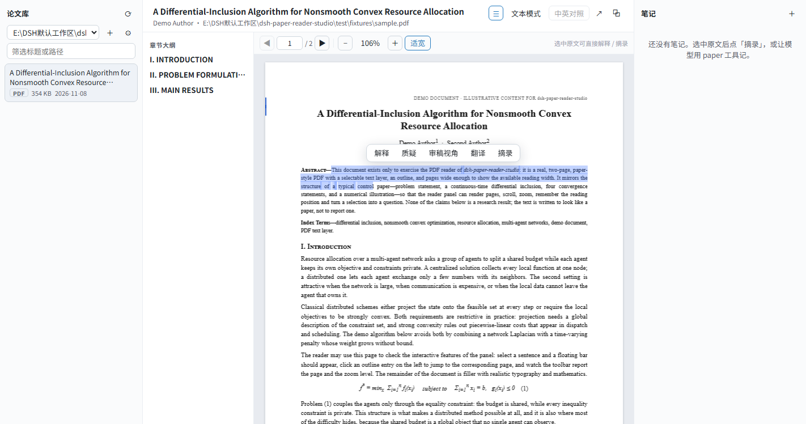

# 论文阅读器（dsh-paper-reader）

给 DeepSeek Harness 装一个「论文」页：论文库 → 章节大纲 → 正文（TeX 走 KaTeX，PDF 走页面渲染）→ 中英对照 → 笔记，
选中原文可以直接把它连同出处发进当前对话；同时给模型一套 `paper` 工具，让它按章节读、检索、写笔记、出审稿材料。

仓库：<https://github.com/SpBs2004/dsh-paper-reader>（MIT）

## 打开

左侧栏面板列表里的「论文」图标（`paper-reader`）。主面板三栏：

```
论文库（根目录下拉 + ＋/⚙ 目录管理） │ 大纲 + 正文                    │ 笔记
```

## 论文目录（不需要改配置文件）

左上角根目录栏右侧：

- **＋** 打开「论文目录」弹窗：输入/粘贴绝对路径，点「添加」。
- **⚙** 打开同一个弹窗：看每个目录的来源和论文数，逐项「×」移除。
- 弹窗里的「浏览…」优先调用宿主的原生目录选择器；没有选择器时直接粘贴路径即可。

目录来源分三种：`工作目录`（宿主默认目录，可移除）、`配置默认`（`cordis.patch.yml` 里的 `roots`）、
`手动添加`（面板里加的）。增删即时生效并持久化，不用重启、不用碰配置文件。

状态文件默认是 `<DSH_HOME>/paper-reader/roots.json`（通常是 `C:\Users\<你>\.dsh\paper-reader\roots.json`），
只记录相对配置的 `added` / `removed` 增量——以后改配置仍然生效，面板里移除过的默认目录也不会自己冒回来。
同一个 profile 的会话共用这份目录列表。

## 三种用法

1. **读**：左侧选一篇论文 → 中间出章节大纲和正文。`.tex` 走源码解析（保留行号）；`.pdf` 默认进入**页面阅读**（pdf.js 渲染原版页面，见下节），也可切回文本模式。
   点大纲跳转（PDF 跳到对应页）；标题栏的 `↗` 把文件在**右侧预览**里打开（`.tex` 会跳到当前章节的行）。
2. **问**：在正文里划选一段（PDF 页面阅读同样可选）→ 浮条上选「解释 / 质疑 / 审稿视角」→ 自动切回对话，提问里带论文路径、章节、页码与原文引用。
   「翻译」在浮层里出译文；「摘录」写进论文同目录的 `<论文>.notes.md`。
3. **让模型用**：对话里模型可调用 `paper` 工具：

```
paper({ action: 'list' })                                  # 列论文库
paper({ action: 'outline', path: 'D:/papers/.../x.tex' })   # 章节树
paper({ action: 'read', id: 'abc123', section: 'Convergence analysis' })
paper({ action: 'search', id: 'abc123', query: 'differential inclusion' })
paper({ action: 'note_add', id: 'abc123', note: { kind: 'question', text: '…', quote: '…' } })
paper({ action: 'review', id: 'abc123' })                   # 审稿材料：章节 + 全部定理原文 + 可疑引用
paper({ action: 'bib', id: 'abc123' })
```

`notes_read` / `translate` 同理。`note_add` 是唯一写操作。

## PDF 页面阅读

PDF 默认按原版页面渲染，不再只给提取文本：



- **连续滚动 + 懒渲染**：只渲染进入视口附近的页，离开后释放画布，长文档也不吃内存。
- **工具栏**：上一页 / 页码跳转 / 下一页、缩放 `−` `+`、点百分比恢复 100%、`适宽`（默认）。
- **文本层**：pdf.js 的 TextLayer 覆盖在画布上，选中 PDF 原文与 `.tex` 一样能触发「解释 / 摘录 / 问 AI」，提问里带 `p.N`。
- **阅读位置记忆**：每篇论文记住页码、缩放和适宽状态，下次打开直接回到原处。
- **目录联动**：左侧大纲点击直接跳到对应页。
- **文本模式**：标题栏的「文本模式」回到原来的提取文本视图（可搜索、可复制、可中英对照）。

实现上分两层：

- pdf.js **不打包进 `client.js`**，打开 PDF 时才动态 `import('/paper-reader/static/pdfjs/build/pdf.min.mjs')`；所以面板首次加载不受影响。
- 宿主的 `lib/http.js` 提供两条只读路由：`/paper-reader/file?path=…`（流式返回论文根目录内的 PDF，支持 Range）和 `/paper-reader/static/pdfjs/…`（pdf.js 主包、Worker、字体与 cmaps）。路径用 `realpath` 校验，根目录外的 PDF 一律 404。
- pdf.js 运行时在 `vendor/pdfjs/`，由 `npm run sync:pdfjs` 从 `node_modules/pdfjs-dist` 拷入，运行时不依赖 node_modules。

> 如果打开 PDF 显示「PDF 渲染失败：… 404」，说明宿主还跑着旧代码：**重启一次 DeepSeek Harness**（或让插件重新加载）即可；面板其它功能不受影响。

## 配置

`cordis.patch.yml` 里本插件的 `config`：

| 字段 | 默认 | 说明 |
|---|---|---|
| `roots` | `[]` | **默认**论文目录；面板里增删的目录存在状态文件里，不用改这里 |
| `maxPaperBytes` | 32 MiB | 超过的论文不进库 |
| `maxPages` | 200 | PDF **文本提取**页数上限（页面阅读器渲染全部页） |
| `maxChars` | 400000 | 面板单次返回的正文上限（超出标 truncated） |
| `notes.suffix` | `.notes.md` | 笔记文件后缀 |
| `translation.targetLanguage` / `translation.provider` | `zh` / `null` | `null` = 自动挑匿名 provider（google/bing） |
| `tool.enabled` | `true` | 关掉就只保留面板 |

模型的 `paper` 工具也有 `roots` / `root_add` / `root_remove` 三个 action，和面板共用同一套增删逻辑。

## 笔记文件

`<论文>.notes.md`，追加式，条目格式：

```markdown
## 2026-11-03 18:40 · 摘录 · §3.2 · L412
> 原文引文……

笔记正文……
```

## 已知限制

- PDF 页面阅读依赖宿主路由；插件升级宿主半之后需要重载一次插件（见文末）。
- PDF 里暂不做全文「查找」；需要搜索时切「文本模式」，或用 `paper` 工具的 `search`。
- 扫描版 PDF 没有文本层：页面能正常渲染，但「问 AI」拿不到可选中文本，可切文本模式看提取结果（可能为空）。
- 右侧 PDF 预览不支持「跳到第 N 页」；面板内页面阅读支持。
- 面板内选中的文本无法覆盖右侧预览里的选区（跨面板选区不做）。
- 公式用 KaTeX 的 MathML 输出渲染（不加载 KaTeX 字体），极少数宏可能退回等宽源码。
- 定理编号按 `\newtheorem{…}{…}[section]` 估算；源码用共享计数器时可能与编译结果不一致。

## 开发

```bash
npm install                 # pdfjs-dist + esbuild + react/react-test-renderer（package.json 里已声明）
npm run sync:pdfjs          # 把 pdfjs-dist 运行时拷进 vendor/pdfjs/
npm run build               # sync + 生成 client.js
npm test                    # node --test
npm run make:demo           # 用本机 Chrome 重新生成演示 PDF（test/fixtures/sample.pdf）
npm run smoke:pdf           # 无头 Chrome：pdf.js + Worker + Range + TextLayer（默认演示 PDF）
npm run smoke:ui            # 无头 Chrome：真实面板开 PDF、缩放、切模式、划选原文（默认演示 PDF）
```

`vendor/pdfjs/` 是生成产物，升级 pdfjs 时改 `package.json` 里的版本再跑 `npm run build`。

## 安装

插件以 bundle 形式发布，装进 Harness 的某个 profile：桌面版（`DeepSeek Harness.exe`）是 `desktop`，
`dsh web` 是 `web`。profile 名就是 `%USERPROFILE%\.dsh\profiles\` 下的目录名。

### 方式一：对话里安装（推荐）

在 DSH 会话里直接说：

> 安装插件 github:SpBs2004/dsh-paper-reader

即让模型调用：

```text
plugin_manager(action="install_bundle", target="github:SpBs2004/dsh-paper-reader")
```

### 方式二：命令行安装

需要本机有 `dsh` CLI 和 pnpm（`pnpm -v` 能输出即可）：

```bash
# 桌面版（DeepSeek Harness.exe）
dsh plugin --profile desktop add github:SpBs2004/dsh-paper-reader

# dsh web / 其它 profile 换成对应名字
dsh plugin --profile web add github:SpBs2004/dsh-paper-reader
```

`dsh plugin` 把参数转发给 profile 目录里的 pnpm，安装结束后自动把声明了 `dsh.bundle` 的新依赖
追加进 `dsh.profile.bundles`。**命令行安装不会热加载，装完要重启 Harness。**

确认已进入 bundle 层（Windows 上可接 `| findstr /i paper-reader`）：

```bash
dsh --profile desktop --dump-config
```

卸载和升级（git 依赖会固定在安装时的 commit，升级请先删再装）：

```bash
dsh plugin --profile desktop remove dsh-paper-reader
dsh plugin --profile desktop add github:SpBs2004/dsh-paper-reader
```

### 方式三：从本机目录安装（改代码用）

```bash
dsh plugin --profile desktop add link:E:\path\to\dsh-paper-reader
```

本地 `link:` 安装直接读工作目录里的 `client.js`，改完客户端重新 `npm run build`、刷新页面即可；
之后如果改成 GitHub 安装，依赖会替换成仓库版本，本地改动不再生效。

### 装完

刷新页面（Ctrl+R）。宿主半有改动（例如新增了 PDF 路由）时，需要重载插件——`plugin_manager`
关掉再打开，或重启 Harness；打开 PDF 显示「渲染失败 404」就是这种情形。

## 许可

MIT，见 `LICENSE`。`vendor/pdfjs/` 是 Mozilla pdf.js 运行时（Apache-2.0，许可证随目录提供）；
`test/fixtures/demo.html` 与由它生成的 `sample.pdf` 只用于演示和冒烟测试，内容是虚构的。
